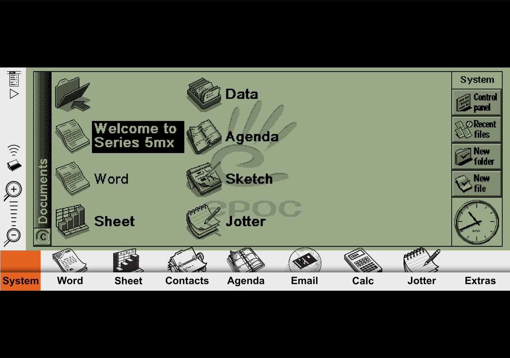
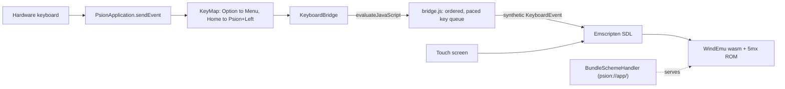

# Psion 5mx for iPhone

[WindEmu](https://wuffs.org/WindEmu/index.html) runs a Psion Series 5mx in a web page, but on an iPhone
the page is a small box with Safari's toolbars round it, it won't stay in landscape, and the Psion's
Menu key (Option on its own) never reaches it. This small iOS app runs Ash Wolf's emulator full screen,
landscape only, with a hardware keyboard. It was built for the iPhone Duo unfolded on a stand with a
folding Bluetooth keyboard in front of it: basically a Psion again.

It works on both of the Duo's screens and when you fold or unfold, and on any other iPhone.



## What the app adds over the web page

- Fills the screen, landscape only. The status bar is hidden and the home indicator auto-hides.
  On the folded outer screen the Psion screen stays clear of the camera cutout.
- Takes keys straight from the hardware keyboard, before WebKit sees them. That's what lets
  Option on its own open the Psion menu, and lets keys the Psion doesn't have map to the
  chord that does the same job (table below).
- Holds each key down long enough for the emulated Psion to read it, and keeps keys in order,
  so fast typing doesn't drop letters, merge "ll" into one l or lose capitals.
- Works offline. The emulator is bundled into the app, not loaded from the web each time.
- Edge swipes need a second swipe, so tapping the silkscreen icons near the edge won't throw
  you out of the app.

## Build and install

You need Xcode, [XcodeGen](https://github.com/yonaskolb/XcodeGen) (`brew install xcodegen`) and an Apple
developer account (a free one works, but the app then expires after 7 days).

```bash
make setup                         # download WindEmu (and its ROM) from wuffs.org, generate the Xcode project
make sim                           # try it on the iPhone Duo simulator
make device DEVICE="<phone name>"  # build, install and launch on your phone
```

For `make device`, connect the phone by cable (or pair it in Xcode > Devices) and turn on
Settings > Privacy & Security > Developer Mode. `xcrun devicectl list devices` shows the name to use.
Set `DEVELOPMENT_TEAM` in `project.yml` to your own team ID.

You can also open `Psion5.xcodeproj` in Xcode and press Run.

### TestFlight

```bash
make testflight   # archive, export and upload a new build
```

This needs an App Store Connect API key (`ASC_KEY_ID`, `ASC_ISSUER_ID`, `ASC_KEY_PATH`, in the
environment or `~/.appstoreconnect/brain.env`) and an app record for your bundle ID, which you create
once in the App Store Connect web UI. Builds bundle Psion's ROM, so only give them to internal testers.

## Keys

| Your keyboard | Psion 5mx |
| --- | --- |
| Letters, digits, Space, Enter, Tab, Backspace, `'` `,` `.`, arrows | Same key |
| Shift, Ctrl | Shift, Ctrl |
| Option (either) | Menu |
| Cmd (either) | Psion (Fn) key |
| Esc, or `` ` `` | Esc |
| Forward Delete | Shift + Del (delete right) |
| Home / End | Psion + Left / Right |
| Page Up / Page Down | Psion + Up / Down |

Psion shortcuts are mostly Ctrl + letter (Ctrl+N new file, Ctrl+E close and so on), so they don't
collide with iOS. iOS still keeps a few system shortcuts for itself, such as Cmd+Space, Cmd+Tab and
Cmd+H.

Keys with no Psion equivalent (`- = [ ] \ ; /` and the function keys) do nothing yet. On a real
5mx those symbols come from key combinations, so for now type them the way the Psion keyboard does.

The touch screen works as the Psion's: tap the silkscreen icons (System, Word, Calc...) and the
on-screen buttons.

## Limitations

- **Nothing is saved.** The emulator has no save state, so the Psion cold-boots each time the app
  starts, and anything on its C: drive goes when iOS kills the app. It keeps running while the app
  is in memory, including across fold and unfold.
- No sound, serial or infrared, the same as WindEmu itself.

## How it works



`Psion5/Web` holds a small page (`index.html`, `bridge.js`) around WindEmu's Emscripten build.
A `WKURLSchemeHandler` serves it at `psion://app/`, because WKWebView can't `fetch()` the `.wasm`
from a `file://` URL. `PsionApplication` overrides `sendEvent` to catch keyboard presses before
UIKit delivers them, `KeyMap` turns each into Psion keys, and `KeyboardBridge` replays them into
the page, where `bridge.js` paces them for the emulator.

## Credits and licences

This app's code is MIT licensed (see [LICENSE](LICENSE)). WindEmu is by Ash Wolf ([Treeki/WindEmu](https://github.com/Treeki/WindEmu)), MPL-2.0. The emulator files
are not in this repo: `scripts/fetch-windemu.sh` downloads them from wuffs.org at build time. They
include the Psion 5mx ROM, which is Psion's copyright, so keep builds to your own devices. Don't put
one on the App Store or a public TestFlight.
